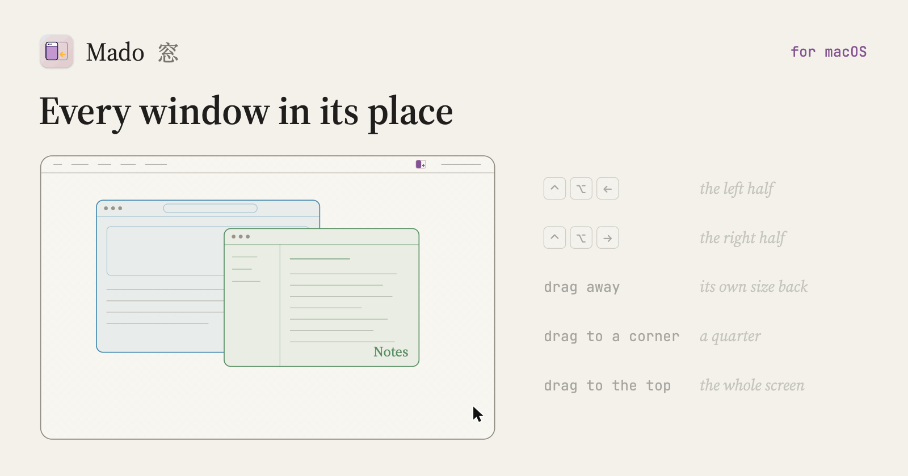

# Mado 窓

*Every window in its place.*

[Download](https://github.com/alkaline-software/mado/releases/latest) · [Changelog](CHANGELOG.md)

Mado sizes and places your Mac's windows. Press a shortcut, or drag a window to an edge or a corner of the screen, and it takes a half, a quarter or the whole screen. Drag it away again and it takes back its own size. Every shortcut is yours to set.

Mado lives in the menu bar. It asks for Accessibility, which macOS requires of any app that moves another app's windows.

An Alkaline Software app, MIT licensed.
